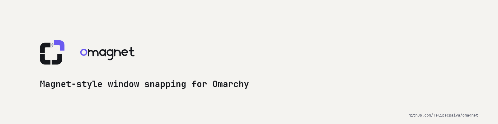

<p align="center">
  <picture>
    <source media="(prefers-color-scheme: dark)" srcset="branding/social/banner-dark.png">
    
  </picture>
</p>

Magnet-style window snapping for Omarchy's **floating workspace mode**. Press a shortcut or drag a window to a screen
edge, and it snaps to a half, third, quarter or the whole screen. It does nothing on dwindle or scrolling workspaces.

omagnet is two parts in one repo:

- **The snapping module** (`lua/`): pure Lua on Hyprland's own Lua API. No native code, so a Hyprland update cannot break
  a compiled module.
- **The settings app** (this folder is an Omarchy plugin): a settings window opened from the launcher. It adds nothing
  to the bar unless you switch on an optional icon.

Status (2026-11-05): everything on the [roadmap](docs/ROADMAP.md) is built and tested except a visual editor for custom
positions and the marketplace listing. The checks that need a person at the machine are in
[docs/validation-checklist.md](docs/validation-checklist.md). Every claim in the docs says how it was checked.

## What it does

- **Keyboard** (`CTRL + ALT`): arrows for halves, `U I J K` quarters, `D F G` thirds, `E T` two thirds, `Return`
  maximize, `C` centre, `Backspace` restore the size from before the first snap. `SUPER + CTRL + ALT` with `Left` or
  `Right` sends the window to the previous or next monitor.
- **Drag** (hold `SUPER` and drag with the left mouse): an outline shows the target, in the colour of your theme's window border; let go to snap. Corners give
  quarters, left and right edges halves, the top edge maximizes, the bottom edge gives thirds (slide along it for two
  thirds). On a vertical screen the side edges give thirds. Dragging a snapped window away gives it its old size back.
- **Gaps** between snapped windows (8 pixels by default, none against the screen border), space kept free for a dock.
- **Your own positions and shortcuts**, an ignore list of apps, and the look of the outline, all in
  `~/.config/omagnet/config.toml` or in the settings window. See [docs/config.md](docs/config.md).

Anything that is not a floating-workspace window is left alone, and a key pressed in one goes on to the app.

## Install

1. **Add the plugin** (the settings app, and the repo's Lua module comes with it):

   ```
   omarchy plugin add https://github.com/felipecpaiva/omagnet --enable
   omarchy restart shell        # once: a plugin added while the shell runs is not built properly until then
   ```

   It adds a launcher entry, "omagnet". It adds nothing to the bar. Omarchy's theme picker opens whenever the shell
   restarts; press `Escape` to close it.

2. **Load the snapping module.** Installing a plugin does not edit your Hyprland config, so add one line to the end of
   `~/.config/hypr/hyprland.lua`, then run `hyprctl reload`:

   ```lua
   pcall(dofile, os.getenv("HOME") .. "/.config/omarchy/plugins/io.github.felipecpaiva.omagnet/lua/omagnet-snap.lua")
   ```

   The `pcall` means a missing or broken file never breaks the rest of your config. To remove it, delete the line.

3. Switch a workspace to floating mode (`Super + L` cycles the layouts) and try `Ctrl + Alt + Left`.

**Remove:** delete the line above, then `omarchy plugin remove io.github.felipecpaiva.omagnet`.

## Settings

Open "omagnet" from the launcher, or run `omarchy-shell shell toggle io.github.felipecpaiva.omagnet`. Changes are saved
as you make them. Spacing, zones, switches, the ignore list and the outline look apply to the next snap. A changed
shortcut needs `hyprctl reload`, and the window has a button for it. The file it edits keeps anything it does not know,
so anything it does not edit is never lost.

Custom positions have their own editor: each existing one shows a thumbnail, its shortcut field and a delete button, and
"Add position" gives a 24 by 14 grid where you press and drag to pick the size and place, like Magnet's. Click a
thumbnail to change that position. A new or re-keyed shortcut needs the Hyprland reload; a changed rectangle applies live.

"Show an icon in the bar" adds a small button that opens the settings window. Off (the default), the bar looks exactly as
it did before. The plugin declares a bar widget so Omarchy can place one, and the widget hides itself with zero size.

## Layout of the repo

```
manifest.json, SettingsPanel.qml, SettingsStore.qml, Service.qml, BarWidget.qml, ConfigIO.js, Paths.js, omagnet.desktop
                     the settings plugin (the repo root is the plugin, as Omarchy's installer and marketplace expect)
lua/                 the snapping module: geometry.lua, config.lua, omagnet-snap.lua, preview.qml, and its unit tests
tests/               run-all.sh, live tests (virtual keyboard, mouse and monitor), the Node test, scrub.sh
docs/                roadmap, architecture, settings, gotchas, history, research
```

| Document | What it holds |
|----------|---------------|
| [docs/architecture.md](docs/architecture.md) | The parts, how they talk, the approaches compared and why these were chosen |
| [docs/ROADMAP.md](docs/ROADMAP.md) | Every function, its status, the rules, the batch order |
| [docs/validation-checklist.md](docs/validation-checklist.md) | What only a person can check, as ticks, about ten minutes |
| [docs/config.md](docs/config.md) | Every setting, the default shortcuts and the drag zones |
| [docs/gotchas.md](docs/gotchas.md) | The traps found while building it (Hyprland Lua 5.5, key strings, maximized windows, shell caching) |
| [docs/batch-log.md](docs/batch-log.md) | What each batch changed, its tests and results |
| [docs/magnet-reference/](docs/magnet-reference/) | What Magnet does, from its website and store screenshots |
| [docs/research/](docs/research/) | Existing snappers, Omarchy's community, what Hyprland can do, how plugins are built |

## Tests

```
bash tests/run-all.sh --no-live     # unit tests, the Hyprland glue with a fake hl, scrub, Node test, plugin validation
bash tests/run-all.sh               # also the live test: real key and mouse events on a throwaway window (about 2 minutes)
python3 tests/live_displays.py      # adds a temporary virtual monitor (about 30 seconds)
python3 tests/live_overlay.py       # the drag overlay settings, with a screenshot
```

Run the Lua tests with Lua 5.5, the version Hyprland embeds: 5.4 accepts code that 5.5 rejects. The live tests drive your
real keyboard, mouse and focus, so keep your hands off the machine while they run. The same is true of Omarchy's theme
picker: it opens when its shell reloads and takes keyboard focus, so close it before a live run.

## Rules for this project

1. [Magnet](https://magnet.crowdcafe.com/) (macOS) is the quality bar. Every function gets ported or a written reason why not.
2. Floating workspaces only. Tiled and scrolling workspaces are never touched.
3. Nothing on the Omarchy bar by default. The icon is an option.
4. No native code.
5. Public repo: no LAN addresses, hostnames, home paths or client names. `tests/scrub.sh` checks before every push.

MIT license.

omagnet is an independent project. It is not affiliated with or endorsed by Omarchy, or by Magnet or its makers (BOOTCODE A.S.).
"Magnet-style" describes what it does; the names belong to their owners.
