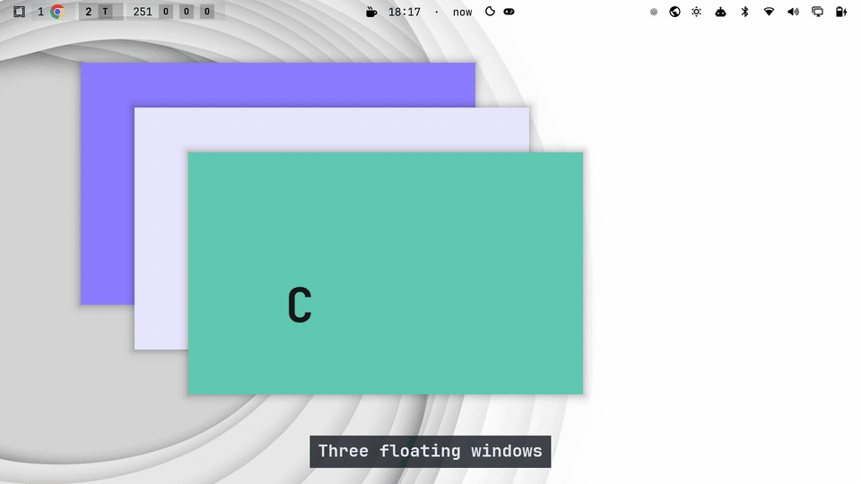

# omagnet v0.1.0

Magnet-style window snapping for Omarchy's floating workspaces. Press a shortcut or drag a window to a screen edge, and it snaps to a half, third, quarter or the whole screen. Nothing happens on dwindle or scrolling workspaces.



## What is in it

- **18 keyboard shortcuts** on `CTRL + ALT`: arrows for halves, `U I J K` for quarters, `D F G` for thirds, `E T` for two thirds, `Return` to maximize, `C` to centre, `Backspace` to restore the size from before the first snap. `SUPER + CTRL + ALT` with `Left` or `Right` sends the window to the previous or next monitor.
- **Drag to snap.** Hold `SUPER`, drag with the left mouse, and an outline in your theme's window border colour shows the target. Corners give quarters, side edges give halves, the top edge maximizes, the bottom edge gives thirds. Dragging a snapped window away gives it its old size back.
- **Gaps** between snapped windows (8 pixels by default, none against the screen border) and space you can keep free for a dock.
- **Your own positions** with a 24 by 14 grid editor (press and drag to pick size and place), your own shortcuts, and an ignore list of apps.
- **A settings window** in the launcher ("omagnet"). It adds nothing to the bar unless you switch on the optional icon.
- **Pure Lua** on Hyprland's own Lua API. No native code, so a Hyprland update cannot break a compiled module.

## Install

```
omarchy plugin add https://github.com/felipecpaiva/omagnet --enable
omarchy restart shell
```

Then add one line to the end of `~/.config/hypr/hyprland.lua` and run `hyprctl reload`:

```lua
pcall(dofile, os.getenv("HOME") .. "/.config/omarchy/plugins/io.github.felipecpaiva.omagnet/lua/omagnet-snap.lua")
```

Switch a workspace to floating mode (`Super + L` cycles layouts) and try `Ctrl + Alt + Left`. Omarchy's theme picker opens whenever the shell restarts, press `Escape` to close it. To remove: delete the line, then `omarchy plugin remove io.github.felipecpaiva.omagnet`.

## How it was checked

Unit tests for the geometry and the config reader, a glue test with a fake `hl` object, and live tests that send real key and mouse events through a virtual keyboard and mouse on a throwaway window. The live tests also ran on a virtual monitor at scale 2, 1.5 and 1.25, and rotated. The settings window was loaded into the real shell and used.

## Known limits

- **Not tried on a real second monitor or a real vertical monitor.** Virtual monitors only so far.
- A drag started from an app's own title bar (Chrome, VS Code) is not seen. Hyprland sends no event for it and fixing that needs a native plugin, which this project avoids on purpose.
- Top and bottom halves by drag are not built (Magnet's drawings for them were unclear to me).
- Needs Hyprland with the Lua config API (tested on 0.56.2). Lua 5.4 accepts code that Hyprland's embedded 5.5 rejects, so run the tests with 5.5.

## Credits and the other projects

[Magnet](https://magnet.crowdcafe.com/) for macOS is the quality bar, and omagnet only borrows its idea. Two community plugins already do edge snapping on Omarchy: Gridnet (`hudrucan/omarchy-gridnet`) and Zones (`austinwilkerson/omarchy-zones`). I read their READMEs and did not run them. omagnet is a different choice (pure Lua, keyboard first, no bar icon), not a verdict on theirs.

omagnet is an independent project. It is not affiliated with or endorsed by Omarchy, or by Magnet or its makers (BOOTCODE A.S.). MIT license.
