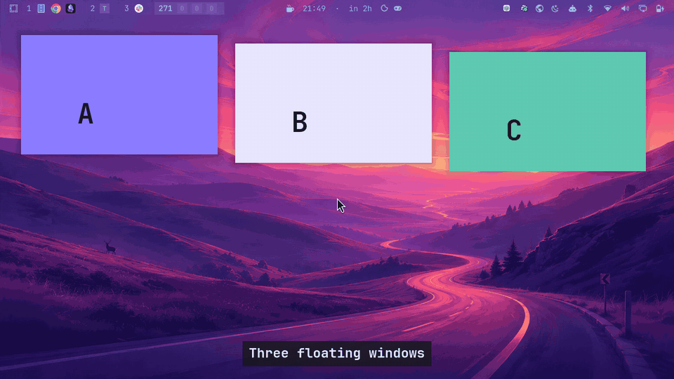
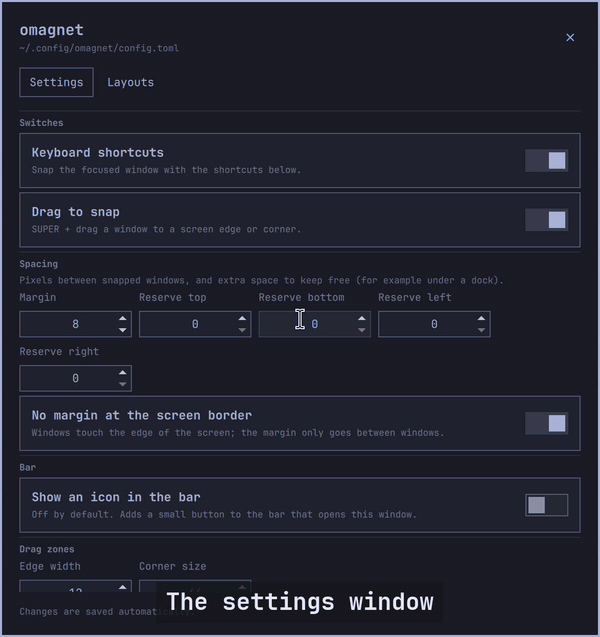

Grid zones, a layout editor, and layouts that fit your screen. Everything from v0.1.0 still works the same.

## What is new

- **Grid zones** (the idea from PowerToys FancyZones). Hold `SUPER + SHIFT` and drag a window, or press `SHIFT` in the middle of a `SUPER` drag: the screen shows a grid, the cell under the pointer is outlined in your theme colour, and letting go snaps the window to it. Near the line between two cells a drop fills both. `SHIFT` let go hides the grid and the edge zones are back. A plain `SUPER` drag is unchanged.
- **Layouts that fit the screen with no setup.** The default layout is `auto`, picked from each monitor's size and shape: two columns on a laptop (a Z13 at scale 2), halves and quarters on full HD, six cells on bigger monitors, 25/50/25 on a 21:9 ultrawide, four columns on a 32:9, rows on a portrait monitor. Or choose `columns:N`, `rows:N`, `grid:CxR`, `priority`, or your own rectangles.
- **A layout editor** in the settings window (the new **Layouts** tab). Gallery of layouts with thumbnails, your screens drawn in their real shape, split and merge zones, drag the dividers, or draw free rectangles. **Show on screen** draws a layout on your monitors before you use it.

- **A layout per monitor and per workspace.** Order: a layout picked by key, the workspace's, the monitor's, then `auto`.
- **New keys:** `CTRL + ALT + ]` and `[` step the focused window through the zones. `layout_next` and `layout_prev` switch layouts (no default key).

## Fixed

- Letting go of `SUPER` before the mouse button left the drag "on": the grid stayed up, and a window that had just been restored from a snap kept following the pointer until you clicked. This was already possible with a plain `SUPER` drag. Now a drag ends as soon as `SUPER` is gone.
- An overlay process could be left running after a drag. A stop now waits a moment so it cannot land before its own start.

## How it was checked

Unit tests, a fake-Hyprland test, and live tests with a virtual keyboard and mouse: every cell of a grid, two-zone drops, SHIFT in the middle of a drag, every order of letting go of the keys and the mouse (15 orders, 45 checks), and, on a laptop screen plus two real external monitors, sending a window round all three, snaps and zone drops on each, and a layout per monitor and per workspace. A random-edit test checks the editor operations always keep the screen tiled exactly. The settings window was driven in the real shell, on a laptop screen and two real external monitors.

## Known limits

- **A monitor whose workspace is not in floating mode:** Omarchy takes the floating tag off a window the moment it lands there, so omagnet (rightly) does nothing. Switch the workspace to floating with `Super + L`.
- Tried by hand in the editor: split, divider drag, merge, save, apply and delete. Not tried by hand: the canvas drag and corner resize (unit tested only), and a vertical real monitor. Renaming a layout is refused on purpose.
- Drags started from an app's own title bar are still not seen. Top and bottom halves by drag are still not built.

## Update

**Marketplace:** the plugin is submitted to the Omarchy plugin marketplace ([plugins.omarchy.org](https://plugins.omarchy.org/)) and is in review, so it is not listed there yet ([the submission](https://github.com/omacom/omarchy-plugin-marketplace/issues/14036)). Until it is, install straight from this repo, as below.

`omarchy plugin update io.github.felipecpaiva.omagnet`, then `omarchy restart shell`, then `hyprctl reload` (new binds). Your `config.toml` keeps working; the new settings are optional.

omagnet is an independent project. It is not affiliated with or endorsed by Omarchy, Microsoft or Magnet. MIT license.
